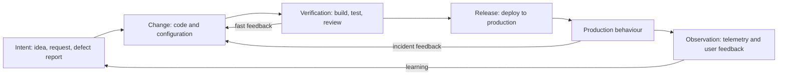
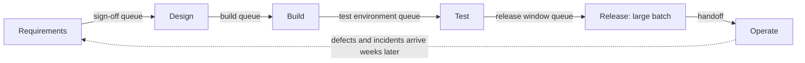
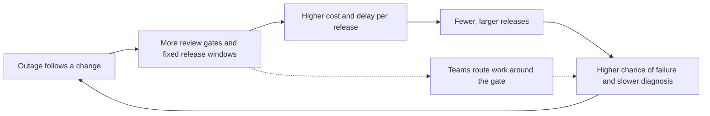

# Chapter 1 — From Silos to DevOps: Evolution, Principles, and Culture

| Field | Value |
|---|---|
| Chapter ID | `CH-001` |
| Part | `P01` — DevOps Engineering Foundations |
| Sections | 1.1 Evolution of software engineering and operations · 1.2 DevOps principles and culture |
| Status | **Planned** (drafting in progress) |
| Drafting progress | Front matter, chapter foundations, and concepts 1.1.1 and 1.1.2 are drafted. Concepts 1.1.3–1.1.5, section 1.2, and the chapter-level components are planned. **Nothing in this chapter has been practically validated.** |
| Version | 0.2.0 · 2026-11-16 |
| Labs | `LAB-001-01` and `LAB-001-02` drafted (not yet run) · `LAB-001-03`–`LAB-001-10` reserved, not yet written |

### Version baseline

This chapter relies on no version-sensitive tool. It assumes Git, read access to a CI system, and a Mermaid-capable viewer (GitHub renders Mermaid). Version baseline tables begin in Chapter 2.

## Chapter introduction

DevOps is often introduced as a toolset: a CI server, containers, infrastructure as code. That describes how many organisations now work; it does not explain *why*. This chapter builds the explanation. Every practice you will meet in this book, from small batches to blameless postmortems to progressive delivery, is a response to a specific constraint in how software used to be built and run. If you know the constraint, you can judge whether a practice fits your situation, adapt it when it does not, and defend your reasoning in a design review or an interview. If you know only the tool, you will configure it the way the tutorial did.

The chapter has two sections. **Section 1.1** follows software delivery from the era of batch computing to the cloud and isolates the mechanisms (queues, batch size, handoffs, feedback delay) that made older approaches slow and risky. **Section 1.2** turns to the principles and culture that DevOps adopted in response, and to how delivery performance is measured.

The chapter is built around laboratories, not memorisation. You will measure a real delivery path, and then deliberately test whether your measurements deserve to be trusted.

**How to work through it.** Read concept 1.1.1, then do Phase 1 of [`LAB-001-01`](../../labs/ch-001/LAB-001-01-value-stream-map.md). Reply with your results. The mentor evaluates them and releases the Phase 2 failure before moving on. Concept 1.1.2 and `LAB-001-02` have been released early so that you are not blocked; they reuse your `LAB-001-01` data, so do that lab first. Evaluation and each Phase 2 still follow your submissions. Complete [`BASE-01`](../../labs/diagnostic/BASE-01-baseline-assessment.md) before or alongside the lab; it does not depend on this chapter.

## Why this matters in professional engineering

1. **Constraint-first reasoning transfers; tools do not.** Jenkins, Docker, and Kubernetes will be replaced. The mathematics of queues and the economics of batch size will not.
2. **It turns opinion into evidence.** "The pipeline is slow" is an opinion. "Changes wait 80% of their lead time between merge and deploy, and here are the timestamps" is an argument that can win a decision about where to invest.
3. **It shapes how you behave in incidents.** Blameless, evidence-driven investigation is a cultural practice with technical consequences for what gets fixed.
4. **It is what interviewers and design reviewers probe.** "Why did you choose this?" and "what did you consider instead?" cannot be answered by naming a tool.
5. **It protects you from tool-first adoption**, the most common way organisations buy a toolchain and keep their old delivery problems.

## Prerequisites

- You can read a Git history (log, branches, tags) and a CI build log.
- You have shipped at least one change to a running environment. This is **your claim**; BASE-01 and LAB-001-01 will test it.
- Read-only access to the history of one real delivery path (an AirDive service, or the public fallback described in the lab).
- No other chapters.

## Learning objectives

By the end of this chapter you will be able to:

| ID | Objective | Tested by |
|---|---|---|
| LO-1 | Explain, using queueing and batch-size reasoning, why plan-driven batch delivery produces long and unpredictable lead times | §1.1.1 checkpoint; `LAB-001-01` |
| LO-2 | Construct and verify a value stream map of a real delivery path, computing lead time, process time, and flow efficiency from sourced timestamps | `LAB-001-01` Phase 1 |
| LO-3 | Separate evidence from assumption in operational data, and detect when a measurement is untrustworthy | `LAB-001-01` Phases 2–3 |
| LO-4 | Describe the incentive conflict between development and operations and how change control and handoffs reinforce it | §1.1.2 checkpoint; `LAB-001-02` |
| LO-5 | Explain how Agile practice and small batches shorten feedback loops, and demonstrate the effect experimentally | §1.1.3 (planned) |
| LO-6 | Explain how virtualisation and cloud turned infrastructure into something that can be versioned and automated | §1.1.4 (planned) |
| LO-7 | Distinguish DevOps, site reliability engineering (SRE), and platform engineering as answers to related constraints | §1.1.5 (planned) |
| LO-8 | State DevOps principles and cultural practices, and critique tool-first adoption | §1.2 (planned) |
| LO-9 | Use the DORA delivery metrics correctly, including their limits | §1.2.4 (planned) |

## Chapter contents

- **Chapter foundations** — *Drafted*
  - 1.0.1 What is a delivery system?
  - 1.0.2 Internal architecture and working mechanisms
- **1.1 Evolution of software engineering and operations**
  - 1.1.1 Plan-driven delivery, batch releases, and queues — **Drafted** · `LAB-001-01` (drafted, not yet run)
  - 1.1.2 The development–operations divide: incentives, handoffs, and change control — **Drafted** · `LAB-001-02` (drafted, not yet run)
  - 1.1.3 Agile and small batches: shortening the feedback loop — *Planned* · `LAB-001-03`
  - 1.1.4 Virtualisation, cloud, and infrastructure as software — *Planned* · `LAB-001-04`
  - 1.1.5 Three lineages: DevOps, SRE, and platform engineering — *Planned* · `LAB-001-05`
  - `IA-1.1` Integrated assessment — *Planned*
- **1.2 DevOps principles and culture**
  - 1.2.1 Flow, feedback, and learning — *Planned* · `LAB-001-06`
  - 1.2.2 Describing DevOps: frameworks and their limits — *Planned* · `LAB-001-07`
  - 1.2.3 Culture, psychological safety, and blameless learning — *Planned* · `LAB-001-08`
  - 1.2.4 Measuring delivery performance — *Planned* · `LAB-001-09`
  - 1.2.5 Anti-patterns: tool-first adoption and the "DevOps team" silo — *Planned* · `LAB-001-10`
  - `IA-1.2` Integrated assessment — *Planned*
- **Chapter-level components** (integrated simulations, case studies, perspectives, project, checklist, assessments, summary) — *Planned*

## Chapter foundations

### 1.0.1 Foundational technical explanation: what is a delivery system?

A **delivery system** is the combination of people, process, tooling, and environments that turns an intention (a feature request, a defect report, a security patch) into changed behaviour of software running in production, and then observes the result. It includes the obvious parts (the repository, the build server, the deployment script) and the less visible ones: who may approve a release, which environment must be booked first, and who knows how to roll back.

Four questions describe any delivery system:

1. *How long does a change take to reach production?* (**lead time**)
2. *How often do changes reach production?* (**deployment frequency**)
3. *How often does a change cause a problem?* (**change failure rate**)
4. *How quickly do we recover when something goes wrong?* (**time to recover**)

These correspond to the first four delivery measures of the DevOps Research and Assessment (**DORA**) programme. DORA's current model uses five measures in two groups: *throughput* (change lead time, deployment frequency, failed deployment recovery time) and *instability* (change fail rate, deployment rework rate). The model was updated in 2024, and the recovery measure had been renamed in 2023 from its older name, *mean time to restore*. [REF-001] Section 1.2.4 treats these measures properly, including how they can be misused; the four questions are enough for now.

Two properties of this definition matter. First, the system includes **the people and the waiting**, not just the tools. Second, it is a **loop**: observing production feeds the next intention, so the speed of delivery sets the speed at which an organisation learns.

### 1.0.2 Internal architecture and working mechanisms

Three mechanisms govern how any delivery system behaves. They are named here and used throughout the book.

| Mechanism | Meaning | How it is observed |
|---|---|---|
| **Flow** | Work moves through stages and spends most of its life waiting in queues between them | Lead time, process time, work in progress (WIP), throughput |
| **Batch size** | The amount of change released together; it sets the risk per release and the cost of diagnosing a failure | Changes per deployment; time to isolate a failure |
| **Feedback delay** | The time between making a change and learning whether it was good | Time from commit to test result; from deploy to detected problem |

*FIG-003 — A generic delivery system. Each forward arrow is a handoff that can add a queue; each feedback arrow has a delay.*

**Forward references.** Flow and WIP are developed in `CH-003` (CI/CD foundations) and `CH-025` (code review as a queue). Batch size returns in `CH-024`, `CH-026`, and `CH-060` (progressive delivery). Feedback delay returns in `CH-027`, `CH-057`, and `CH-091`–`CH-097` (observability).

---

## 1.1 Evolution of software engineering and operations

This section follows delivery from the era of batch computing to the cloud. For each stage it asks the same two questions: *what was the constraint, and what did people do about it?* The stages overlap, and many organisations have not fully left any of them.

| Concept | Core mechanism | Laboratory | Status |
|---|---|---|---|
| 1.1.1 Plan-driven delivery, batch releases, and queues | Flow, batch size, handoffs | `LAB-001-01` | **Drafted** |
| 1.1.2 The development–operations divide | Structural incentive conflict; gates and queues; adaptation around gates (mechanisms 6–8) | `LAB-001-02` | **Drafted** |
| 1.1.3 Agile and small batches | Batch size; feedback delay | `LAB-001-03` | Planned |
| 1.1.4 Virtualisation, cloud, and infrastructure as software | Provisioning lead time | `LAB-001-04` | Planned |
| 1.1.5 Three lineages: DevOps, SRE, platform engineering | Different answers to the same constraints | `LAB-001-05` | Planned |

### 1.1.1 Plan-driven delivery, batch releases, and queues

#### 1.1.1.1 Concept explanation

**What this concept covers.** Before the practices now grouped under "DevOps" existed, most organisations delivered software through a chain of specialised functions: people who gathered requirements, people who designed, people who wrote code, people who tested, and a separate group who ran production. Work moved along the chain in large groups, with an approval or a handoff at each boundary. This concept explains why that arrangement arose, why it was reasonable in its time, and, most importantly, the mechanisms that make it slow and risky. Those mechanisms still operate in modern systems that run Jenkins, containers, and cloud infrastructure, so the aim is diagnosis, not nostalgia.

**Key terms**

| Term | Meaning in this book |
|---|---|
| Software delivery | The end-to-end path from an intention to changed behaviour in production, including observing the result |
| Plan-driven (sequential) development | Work organised into phases (requirements, design, implementation, verification, release, maintenance) completed largely in order, with sign-off between phases; often called "waterfall" |
| Batch (release) | A group of changes released together. Not the same as *batch processing* in computing, where jobs are submitted and run later without interaction |
| Batch size | How much change goes into one release |
| Handoff | Transfer of work between people, teams, or functions |
| Queue | Work waiting for a resource: a person, an environment, an approval, a release window |
| Work in progress (WIP) | Items started but not finished |
| Throughput | Items completed per unit of time |
| Lead time | Elapsed time from the start of an item (as you define it) to its delivery to users |
| Process time | Time an item is actively being worked on |
| Flow efficiency | Process time ÷ lead time. Value stream mapping literature also calls this *process cycle efficiency* [REF-006] |

**Why plan-driven delivery arose.** Three pressures, each reasonable at the time.

1. *Scarce, expensive computing and batch processing.* In many early computing environments, programs were submitted as jobs and results came back hours or days later. Each run was precious, so heavy desk-checking and up-front design were rational habits. Feedback was slow because of the machine, not because of the team. *(General historical context; not separately sourced.)*
2. *The "software crisis" and the birth of "software engineering".* In October 1968 a conference sponsored by the NATO Science Committee met at Garmisch, Germany, under the title *software engineering*. According to a later account by a participant, the title was chosen deliberately to provoke: to suggest that building software should rest on the kind of foundations and discipline found in established engineering fields. The conference is commonly associated with the idea of a "software crisis", the usual summary being large systems that were late, over budget, and unreliable. [REF-002]
3. *Physical engineering as the model.* If you are building a bridge, changing the design after construction is very expensive, so you design carefully first and build second. A stage-gated lifecycle borrows that logic. A much-cited 1970 paper by Winston Royce (IEEE WESCON) draws such a sequence (requirements, design, coding, testing, operations) but is frequently misread: Royce described implementing it as a single pass as risky and likely to fail, because testing at the end is the first time many risks (timing, storage, input and output behaviour) are actually experienced. He proposed additional features to reduce that risk, which secondary accounts summarise as including iteration and building a pilot first. The word "waterfall" attached to the simplified one-pass picture later; one account suggests it first appeared in print in a 1976 paper by Bell and Thayer. [REF-003]

**When plan-driven delivery is a sound choice.** When requirements are stable and well understood; when changing something after release is expensive or dangerous (firmware, medical devices, aerospace); when regulators require design evidence and traceability; or when the interface to the rest of the system is fixed. "Waterfall is bad" is not an engineering argument. "In this context, the cost of change and the rate of learning favour short feedback loops" is.

**Where it breaks: five mechanisms.**

*Mechanism 1 — Waiting dominates elapsed time.* In a sequential pipeline with several specialist stages, an item spends most of its life in queues between stages. The share of lead time spent being actively worked on is the **flow efficiency**. *Illustrative example (not a measurement):* an item needs 1.5 days of hands-on work but is delivered 15 working days after it was requested, so flow efficiency is 1.5 ÷ 15 = 10%. Making people faster during their 1.5 days barely changes the result; shortening the queues does.

*Mechanism 2 — Little's Law links lead time, WIP, and throughput.* For a system that is stable over the long run, the average number of items in the system equals the average arrival rate multiplied by the average time an item spends in the system: **L = λW**. For delivery this rearranges to:

> **average lead time = average WIP ÷ average throughput**

The law needs no assumption about how arrivals or service times are distributed, but it does assume a stable system (arrivals roughly equal departures over the long run) and consistent definitions of what counts as "in the system". [REF-004] *Illustrative values:* 30 items in progress and 5 finished per week gives an average lead time of about 6 weeks; 24 in progress and 6 per week gives 4 weeks; cap WIP at 12 with throughput unchanged and it becomes 2 weeks. "Throughput unchanged" is the hard part. In practice, lowering WIP often raises throughput, because less time is lost to switching and waiting, but that is an empirical claim to test in your own data, not a law.

*Mechanism 3 — High utilisation makes waiting grow non-linearly.* Take a single shared resource (a QA team, a release manager, a staging environment) with random arrivals and random service times. In the simplest standard model, the **M/M/1 queue**, the mean time an item spends in the system equals its service time multiplied by **1 ÷ (1 − ρ)**, where ρ is **utilisation**, the fraction of time the resource is busy. [REF-005] *Illustrative values:* at ρ = 50% an item spends 2 times its service time in the system; at 80%, 5 times; at 90%, 10 times; at 95%, 20 times. Real systems are not M/M/1: arrivals and service times have other distributions and there are often several servers. The qualitative shape, with waiting growing sharply as utilisation approaches 100%, is a general feature of queues with random arrivals, even though the exact numbers differ.

*The author checked the M/M/1 relationship by simulation (400,000 jobs per run). The simulated multiples were 1.99, 5.10, and 10.03 at ρ = 0.5, 0.8, and 0.9, against theoretical values of 2, 5, and 10. The script is deliberately not published, so that it does not spoil the optional extension in `LAB-001-01`.*

**Design implication:** spare capacity ("slack") on a shared stage is not waste. It is what keeps queues short.

*Mechanism 4 — Batch size inflates both the chance of failure and the cost of diagnosing it.* If each change independently has probability *p* of introducing a defect that reaches production, the probability that a release of *N* changes contains at least one defect is **1 − (1 − p)^N**. *Illustrative values with p = 5% (invented for illustration):* N = 1 gives 5.0%; N = 5 gives 22.6%; N = 10 gives 40.1%; N = 20 gives 64.2%. Independence is a simplification, and p is not measured; the direction is the point. Two further costs follow. When a large release fails, the cause could be any of the N changes, or an interaction between them, so diagnosis takes longer. And rolling the release back discards the good changes along with the bad.

*Mechanism 5 — Handoffs destroy context and delay feedback.* Each handoff converts tacit knowledge into a document or a ticket and adds a queue. The person who finds a defect is rarely the person who wrote the code, and the longer the gap between writing and feedback, the more of the original context has been lost. Feedback that arrives seconds after a change is usually easier to act on than the same finding reported weeks later. This is a widely held engineering experience; its size varies by context and is not quantified here.

**Architecture of a plan-driven pipeline**

*FIG-002 — A plan-driven pipeline. Every solid arrow is a handoff and a queue; mechanisms 1–5 operate at the arrows. The dotted arrow is the long feedback loop.*

**How this appears in modern systems.** Plan-driven elements persist in regulated industries (medical devices, aviation, automotive), fixed-scope contracts, and large enterprise programmes. More often they hide inside organisations that believe they have moved on. Symptoms to look for in your own pipeline:

- a weekly or monthly release train;
- a manual approval whose only function is to wait for a person;
- a shared staging environment that must be booked;
- a deployment that only one person knows how to run;
- a release branch that accumulates changes for days;
- ticket statuses such as "ready for QA" or "ready for deploy", which are queues with names.

Each one is a queue or a batch. `LAB-001-01` asks you to find them with data rather than by feel.

**Forward references:** `CH-002` (lifecycle and environments), `CH-003` (CI/CD), `CH-025` (code review as a queue), `CH-060` (progressive delivery), `CH-107` (change management).

#### 1.1.1.2 Workplace scenario

**Engineering ticket ENG-LAB-0001 — Where does the time go between "merged" and "live"?**
*Type:* Investigation · *Priority:* Normal · *Requested by:* a product owner *(illustrative)*

A stakeholder asks how long changes really take to reach users and why. Opinions differ: some say the pipeline is slow, some say reviews are slow, some say releases are batched. Nobody has measured it. Before anyone proposes a tool or a new hire, you are asked for an evidence-backed picture of the current delivery path of one AirDive service.

**Your responsibilities**

- Define what counts as a change, and when its clock starts and stops.
- Choose an unbiased sample of recent production changes.
- Build a sourced timeline for each, and separate active time from waiting.
- Compute lead time, process time, and flow efficiency.
- Identify the main constraints and the mechanism behind each.
- State what you could not measure and how that biases the result.
- Propose improvements as testable hypotheses.

**Constraints:** read-only access; no changes to any system; no secrets or internal identifiers in anything you share.

*Names and framing in this scenario are illustrative. The evidence you collect must be real.*

#### 1.1.1.3 Practical laboratory

**Laboratory:** [`LAB-001-01` — Evidence-based value stream map of a real delivery path](../../labs/ch-001/LAB-001-01-value-stream-map.md).

| Phase | Name | Content | Release |
|---|---|---|---|
| 1 | Build and verify | A sourced timeline and value stream map for at least five real changes | **Live** |
| 2 | Break | A challenge to the trustworthiness of your measurements | Withheld until Phase 1 is accepted |
| 3 | Diagnose and recover | Evidence-driven diagnosis and a corrected method | After Phase 2 |
| 4 | Prevent and assess | Architect challenge and checkpoint questions | After Phase 3 |

#### 1.1.1.4 Failure simulation

No system is damaged in this concept. The failure simulation (Phase 2 of the lab) breaks the **method and the evidence**. It presents conditions under which real delivery data misleads, and asks you to notice that your numbers are unreliable and to explain why. That is a legitimate failure simulation: an incorrect measurement sends investment to the wrong place.

The contents are withheld so that the exercise tests your diagnosis, not your memory of this paragraph. Before you look at any data in Phase 2 you will state your hypothesis, what you expect each diagnostic to show, and what result would falsify it.

#### 1.1.1.5 Troubleshooting and verification

How to check your own measurements. Phase 2 will test whether you apply these.

1. **Triangulate.** Every timestamp that matters should be confirmable from a second, independent source, or flagged as single-source.
2. **Define events before measuring them.** "Deployed" could mean the deploy command started, the container started, or the health check passed. Pick one, write it down, and apply it uniformly.
3. **Check structure.** Durations should not be negative, events should occur in a plausible order, and unusually long or short intervals deserve an explanation.
4. **Use one time basis (UTC)** and note whether the clocks involved can be trusted.
5. **Show raw data.** Aggregates hide problems. With small samples prefer median and range, and say that *n* is small.
6. **Say which time you used**: elapsed time or working time.
7. **Record what you could not measure**, and which way that probably biases the result.
8. **Re-derive one number by a different route** (for example, compute lead time from a different pair of events) and explain any difference.

*Questions the mentor will ask in review:* Which timestamp do you trust least, and why? If the pipeline were batching changes, what would you expect to see, and do you see it? Which of your queues are visible in tooling and which exist only in people's heads?

#### 1.1.1.6 Prevention, improvement, and checkpoint

**Improvement levers, mapped to the mechanisms**

| Mechanism | Lever | Developed in |
|---|---|---|
| Waiting dominates | Make queues visible; remove or automate approvals that only wait | `CH-003`, `CH-025`, `CH-061` |
| Little's Law | Limit WIP; finish before starting | `CH-003`, `CH-025` |
| Utilisation | Keep headroom on shared stages; add capacity where queues form | `CH-055`, `CH-105` |
| Batch size | Release smaller and more often; separate deploying from releasing | `CH-024`, `CH-026`, `CH-060` |
| Handoffs | Shared ownership; automate the handoff | `CH-003`, `CH-086` |
| Feedback delay | Automated tests at commit; fast review; production telemetry | `CH-027`, `CH-057`, `CH-091`–`CH-097` |

**Architectural principle.** Do not "fix" a delivery path by adding a tool in front of a queue. Remove the queue or shrink the batch first, then automate what remains.

**Checkpoint questions** *(answers are not stored in this repository; reply with your answers and a confidence rating of 1–5 for each)*

1. A team has 24 changes in progress and finishes 6 per week. Estimate the average lead time using Little's Law. If you cap WIP at 12 and throughput stays the same, what happens? What assumption are you making, and when might it fail?
2. Why does raising the utilisation of a shared test environment from 80% to 95% hurt lead time far more than the 15-point increase suggests?
3. A release contains 12 independent changes, each with a 4% chance of a defect (illustrative). What is the probability the release contains no defect? State the assumption you are making.
4. Name two contexts in which a sequential, stage-gated approach is a sound engineering choice, and say why.
5. Using one real step in your own pipeline, distinguish lead time from process time.
6. Which queues in your delivery path are visible in tooling and which are invisible? How would you make one invisible queue visible?

### 1.1.2 The development–operations divide: incentives, handoffs, and change control

#### 1.1.2.1 Concept explanation

**What this concept covers.** Concept 1.1.1 explained why sequential, batch-oriented delivery is slow. This concept explains a second, organisational cause that compounds it: the separation of *building* software from *running* it, and the conflict that separation tends to create. You will see why the split arose, why the conflict is structural rather than personal, how change control, introduced to reduce risk, can make delivery both slower and riskier, and what the evidence says about alternatives.

**Key terms**

| Term | Meaning in this book |
|---|---|
| Development and operations ("dev" and "ops") | The function that builds and changes software, and the function that runs it in production and holds the pager. In small organisations they are often hats worn by the same people |
| Incentive | What a person or team is rewarded or blamed for, explicitly or implicitly |
| Structural conflict | Conflict that arises from how goals and measures are arranged, so that replacing the individuals does not remove it |
| Change gate | A checkpoint a change must pass before it proceeds: a review, an approval, a checklist, a release window |
| Change advisory board (CAB) | A group, usually outside the team making the change, that reviews or approves changes before release. DORA also calls it a *change approval board* |
| Segregation of duties | A control requiring that a change be approved by someone other than its author, so that no individual has end-to-end control of a process [REF-008] |
| Blast radius | How much of a system, or how many users, a failing change or component affects |
| Hindsight bias | The tendency, once an outcome is known, to see it as having been more predictable than it was |

**Why the split arose.** Three reasons, none of them foolish.

1. *Different skills.* Running a service at scale (capacity, networks, hardware, on-call response) needs a markedly different skill set from building a product, so organisations divided developers and system administrators into separate teams. The arrangement is easy to adopt, draws on a large talent pool, and comes with plentiful tooling. [REF-007]
2. *Someone must hold the pager.* Production is where users are harmed, so one group is made accountable for keeping it running.
3. *Control requirements.* Change management is often the primary control an organisation uses to limit operational and security risk, and segregation of duties is a common regulatory requirement. [REF-008]

**Where it hurts: three mechanisms.** These continue the numbering from concept 1.1.1.

*Mechanism 6 — Structural conflict of incentives.* At their core, developers want to launch features and see them used, while operators want the service not to break while they hold the pager. Because most outages follow some kind of change, the two goals are in tension by construction. (Google's SRE team reports that roughly 70% of the outages it has seen are due to changes in a live system. That is one organisation's experience, not a universal constant.) The groups also differ in background, vocabulary, assumptions about risk, and assumptions about how stable the product needs to be. The SRE book warns that the divide can degrade from a difference of incentives into one of communication, goals, trust, and respect, and describes that outcome as a pathology. [REF-007] Neither side is behaving irrationally: each protects what it is measured on. That is why the conflict is *structural*.

*Mechanism 7 — Gates add queues and inflate batches: the vicious cycle.* A common response to an outage is to add control: a longer launch checklist, a CAB, a fixed release window. Each addition raises the cost and delay of every release (mechanism 1), so releases become less frequent and larger (mechanism 4). Larger releases fail more often and are harder to diagnose, which produces more outages, which prompts more control (FIG-004). DORA's research reports this pattern: heavyweight external approval tends to slow delivery and to produce larger, less frequent batches with greater impact on production and higher change failure rates, and the research found no evidence that more formal external review is associated with lower change failure rates. DORA lists responding to stability problems by adding process as a common pitfall for exactly this reason. [REF-008] DORA collects its data through an annual worldwide survey of professionals and analyses it statistically, using a cross-sectional design [REF-009], so the evidence describes associations across many organisations. It supports the mechanism but cannot prove it for your system; `LAB-001-02` asks you to look for it in your own evidence.

*Mechanism 8 — Adaptation around the gate.* When gates are costly and apply uniformly, the people subject to them adapt. The SRE book describes launch reviews that can grow into long checklists covering every past cause of outage, and development teams that respond by toggling feature flags, shipping incremental updates, or cherry-picking changes so that fewer releases count as launches, or by splitting a product so that fewer features fall under review. [REF-007] The work still happens, but the gate now sees less of the risk. A control that is easy to route around measures compliance with the route, not safety.

*FIG-004 — The control spiral. The solid loop is mechanism 7; the dotted path is mechanism 8. Both are a causal model supported by the sources above, not a measured law.*

**What good control looks like (this is not an argument for no control).** Segregation of duties and risk reduction are legitimate needs. DORA recommends meeting them through **peer review during development**, with reviews, comments, and approvals captured in the team's development platform, supplemented by automation that detects, prevents, and corrects bad changes early: continuous testing, continuous integration, and monitoring. It advises against treating every change identically and against failing to improve the change process using measures such as lead time and change failure rate. It suggests making the regular change process fast and reliable enough to use for emergency changes as well, and it recasts the CAB's role from gatekeeper to coordination, process improvement, and business trade-offs. [REF-008] The SRE answer is complementary: automate progressive rollouts, rapid problem detection, and safe rollback, which removes people from the repetitive parts of change management, and make the risk trade-off explicit with an error budget (developed in `CH-095`). [REF-007]

**How this appears in modern systems.** It is not limited to large enterprises.

- In a small team, dev and ops are *hats*. The conflict shows up as tension between shipping and caution inside one person, and as handoffs between "the person who made the change" and "the person woken at night".
- It appears between teams: a platform team's deployment queue, a security-review ticket, a manager's approval.
- Symptoms to look for: deployments requested by ticket; "deploy on Thursday" windows; change-freeze calendars; approvals by people who cannot evaluate the change; checklists that grow after each incident and never shrink; developers without production visibility; operators without sight of the code or configuration; and an *emergency* path that is faster than the normal one. If the emergency path is faster, the normal path is the problem.

**Forward references:** `CH-025` (peer review and branch protection), `CH-057` (automated checks), `CH-061` (release governance), `CH-089` (policy as code), `CH-095` (error budgets), `CH-096` (postmortems), `CH-107` (change management).

#### 1.1.2.2 Workplace scenario

**Engineering ticket ENG-LAB-0002 — Who knew what, and when?**
*Type:* Investigation · *Priority:* High · *Requested by:* an engineering lead *(illustrative)*

After a production incident, a proposal circulates: every release must in future be approved by a second person outside the team. Before the decision is made, you are asked to reconstruct how information and decisions flowed during **one real incident**, and to test with evidence whether the proposed gate would have changed the outcome and what it would cost.

**Your responsibilities**

- Choose one real incident with enough surviving evidence.
- Build a sourced timeline and a map of who knew what, and when.
- Identify every handoff and what context was kept or lost.
- Separate what was *knowable at the time* from what is known in hindsight.
- Test three candidate gates against the evidence and estimate their cost across all changes, using your `LAB-001-01` data.
- Propose improvements that act earlier or limit the blast radius.

**Constraints:** read-only; blameless language; roles, not names; no secrets or internal identifiers.

*If you wore several hats during the incident, treat each hat as a separate role and note where context was lost between them (for example, between the person who changed the system and the person who diagnosed it at 2 a.m.). Names and framing in this scenario are illustrative; the evidence must be real.*

#### 1.1.2.3 Practical laboratory

**Laboratory:** [`LAB-001-02` — Handoff-chain reconstruction of a real incident](../../labs/ch-001/LAB-001-02-handoff-chain-reconstruction.md).

| Phase | Name | Content | Release |
|---|---|---|---|
| 1 | Build and verify | Timeline, knowledge map, handoffs, decision contexts, and gate analysis | **Live** |
| 2 | Break | A challenge to the fairness and completeness of your reconstruction | Withheld until Phase 1 is accepted |
| 3 | Diagnose and recover | Evidence-driven correction | After Phase 2 |
| 4 | Prevent and assess | Architect challenge and checkpoint questions | After Phase 3 |

**Dependencies.** Use your `LAB-001-01` sample for the gate-cost estimate. The incident can be one of the three you describe in `BASE-01` (question B4). If either is missing, say so and use stated assumptions.

#### 1.1.2.4 Failure simulation

No system is damaged. Phase 2 breaks the **reconstruction**: it tests whether your account of the incident is fair, complete, and robust to evidence that does not fit your narrative. That is a legitimate failure simulation, because a flawed account of an incident produces a flawed control, and flawed controls (mechanisms 7 and 8) are the subject of this concept. The contents are withheld. Before you look at anything in Phase 2, you will state your hypothesis and what would falsify it.

#### 1.1.2.5 Troubleshooting and verification

How to reconstruct an incident from evidence:

1. **Collect evidence before it expires.** Container logs rotate, CI logs are deleted, and chat scrolls away. Copy what you need, redacted, to a safe place.
2. **Use one time basis (UTC)** and build the timeline from sources, not memory. Memory-only entries are labelled *Recollection (unverified)*.
3. **Tag each entry** as an *observation* (what a person or system saw), an *action* (what someone did), or an *interpretation* (what someone concluded). Interpretations are the entries most distorted by hindsight.
4. **For each key decision, write the decision context first:** what information was available at that moment, which options were visible, and what pressures applied. Write it before you describe the outcome.
5. **Guard against hindsight bias.** Knowing the outcome makes the path look obvious. Ask "what would I have done with only this information?", not "why didn't they see it?".
6. **Triangulate** timestamps from two sources where you can.
7. **Check your language.** Roles, not names; descriptions, not judgements; no "should have".
8. **Verify with someone who was there**, if possible, asking them to look for gaps rather than to judge.

*Questions the mentor will ask in review:* Which entries are interpretations rather than observations? What did the decision-maker not yet know? Which of your three gates would have had the information it needed, and at what point? What would it have cost across the other changes?

#### 1.1.2.6 Prevention, improvement, and checkpoint

**Improvement levers, mapped to the mechanisms**

| Mechanism | Lever | Developed in |
|---|---|---|
| 6 Structural conflict | Shared ownership of production outcomes; shared measures instead of opposed ones | `CH-095`, `CH-107` |
| 7 Gates inflate batches | Peer review enforced in the development platform; automated checks; risk-tiered approval | `CH-025`, `CH-057`, `CH-061` |
| 8 Adaptation around gates | Make the safe path the easy path; self-service defaults; policy as code | `CH-086`, `CH-089` |

**Architectural principle.** Replace gates that *inspect* with controls that *prevent*. Put the check where the change is made, keep humans for the judgements machines cannot make, and make the normal path fast and reliable enough to use for emergencies. Do not answer instability by adding a queue.

**Checkpoint questions** *(answers are not stored in this repository; reply with your answers and a confidence rating of 1–5 for each)*

1. Why is the conflict between development and operations described as *structural* rather than personal? What would you change about the structure rather than the people?
2. A team responds to an outage by requiring CAB approval for every release. Using mechanisms 1, 4, and 7, predict two effects on lead time and batch size and one effect on change failure rate. What evidence would you collect to test your prediction in your own system?
3. Name two legitimate purposes of change control. For each, describe a control that meets it without an external approval queue.
4. Why might the share of "emergency" changes be a useful signal about your normal change process?
5. Give one example from your own experience (no names) of a control that people routed around. What did that control end up measuring?
6. In a one-person team, where do the dev/ops conflict and segregation of duties show up? How would you provide an independent check?

### 1.1.3 – 1.1.5 (planned concepts)

These concepts are not yet written. Sources named below must be opened and verified at drafting time, as `EDITORIAL_GUIDELINES.md` §9 requires.

| Concept | Core mechanism | Laboratory concept | Sources to verify at drafting |
|---|---|---|---|
| **1.1.3** Agile and small batches: shortening the feedback loop | Batch size and feedback delay | `LAB-001-03`: a batch-size experiment in a sandbox repository with an injected defect, comparing big-bang and incremental release. To be executed by the author in a sandbox before release | The Agile Manifesto and its history; DORA's capability page on working in small batches |
| **1.1.4** Virtualisation, cloud, and infrastructure as software | Provisioning lead time collapses; infrastructure becomes versionable | `LAB-001-04`: rebuild-from-scratch audit of a disposable host, measuring how much of its state was undocumented | The NIST definition of cloud computing |
| **1.1.5** Three lineages: DevOps, SRE, and platform engineering | Different answers to related constraints | `LAB-001-05`: map current AirDive practices to each lineage with evidence and identify the gap | Origin of the term DevOps (the SRE book's introduction, already read [REF-007], dates its emergence to late 2008; confirm against other primary sources); platform engineering sources |

### Integrated assessment `IA-1.1`

*Planned.* It will be written when concepts 1.1.3–1.1.5 are complete and will combine all five concepts of section 1.1.

## 1.2 DevOps principles and culture

*Planned.* Concepts and laboratories are reserved as listed in the chapter contents. Sources to open and verify at drafting time: the DORA research pages (the metrics page and its history have already been read, [REF-001]), *The DevOps Handbook*, the Westrum organisational-culture typology as used in DORA research, and the Google SRE book's material on blameless postmortems.

| Concept | Core idea | Laboratory concept |
|---|---|---|
| 1.2.1 Flow, feedback, and learning | The three "ways" as a description of the practices | Apply them to your own `LAB-001-01` map |
| 1.2.2 Describing DevOps: frameworks and their limits | Frameworks help communication and mislead when applied mechanically | Score your delivery path against a framework and defend where it misleads |
| 1.2.3 Culture, psychological safety, and blameless learning | Culture is a set of behaviours with technical consequences | Rewrite a real incident narrative without blame, from `INC-AD` evidence |
| 1.2.4 Measuring delivery performance | The DORA measures and how each can be gamed | Compute the measures from real history and show how each could be distorted |
| 1.2.5 Anti-patterns | Tool-first adoption; the "DevOps team" that becomes a new silo | Audit a real pipeline for anti-patterns, with evidence |

## Chapter-level components

| # | Component | Status | Intended content |
|---|---|---|---|
| 12 | Integrated failure simulations | Planned | A cross-concept measurement-failure drill |
| 13 | Integrated troubleshooting exercises | Planned | Incidents whose diagnosis needs the chapter's mechanisms |
| 14 | Real-world case studies | Planned | The learner's own delivery history (needs `INC-AD` evidence) and public primary-source post-incident reports, selected and verified at drafting |
| 15 | Security and reliability considerations | Planned | Delivery data as sensitive data; manual steps and undocumented knowledge as reliability risks |
| 16 | Senior engineer perspective | Planned | |
| 17 | Architect perspective | Planned | |
| 18 | Integrated chapter project | Planned | Test the to-be design from the `LAB-001-01` architect challenge with a small experiment |
| 19 | Production-readiness checklist | Planned | A checklist for a delivery path |
| 20 | Chapter assessment | Planned | |
| 21 | Practical competency assessment | Planned | |
| 22 | Chapter summary | Planned | |

## Glossary additions

*Partial; entries so far are in [`GLOSSARY.md`](../../GLOSSARY.md).* Batch (release), batch size, blast radius, change advisory board (CAB), change gate, change lead time, deployment frequency, DORA, flow efficiency, handoff, hindsight bias, incentive, lead time, Little's Law, M/M/1 queue, plan-driven development, process time, queue, segregation of duties, software crisis, structural conflict, throughput, utilisation, value stream map, waterfall (term), work in progress.

## References

*Partial; full entries and verification levels are in [`REFERENCES.md`](../../REFERENCES.md).*

- `REF-001` DORA, software delivery performance metrics and their history.
- `REF-002` Randell, retrospective on the 1968 NATO Software Engineering Conference.
- `REF-003` Royce, *Managing the Development of Large Software Systems* (1970).
- `REF-004` Little, *A Proof for the Queuing Formula: L = λW* (1961).
- `REF-005` M/M/1 queue results (university lecture notes).
- `REF-006` Value stream mapping terms (Rother and Shook, *Learning to See*; secondary summaries).
- `REF-007` Beyer, Jones, Petoff, and Murphy (eds.), *Site Reliability Engineering*, Chapter 1 (Introduction).
- `REF-008` DORA, *Streamlining change approval*.
- `REF-009` DORA, *Accelerate State of DevOps Report 2024* and the DORA guidebook (research methodology).
