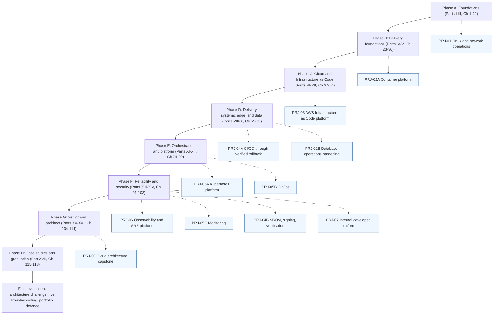

# FIG-001 — Programme phases and project gates

*Caption.* Solid arrows show book order. Dotted arrows show the phase in which a project increment completes. Increments are explained in [`../projects/PORTFOLIO.md`](../projects/PORTFOLIO.md).

*Source of record:* this file. *Last reviewed:* 2026-11-14.
