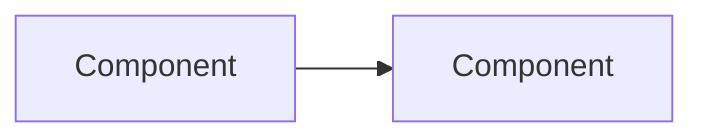

# LAB-NNN-NN — <Title>

> **Assessment mode.** This file gives the scenario, requirements, constraints, and acceptance criteria. It does not give commands or the root cause of any injected failure. Hints are released by the mentor on the ladder in `EDITORIAL_GUIDELINES.md` §6 and are recorded.

## 1. Lab ID
`LAB-NNN-NN`

## 2. Book part and chapter reference
Part `PNN` · Chapter `CH-NNN` · Section `x.y` · Concept `x.y.z`

## 3. Concept being tested
<One or two sentences; name the mechanism being tested, not the tool.>

## 4. Difficulty level
L1–L5 (see `BOOK_PLAN.md` §8).

## 5. Estimated time
<Per phase. State whether the figure is an assumption.>

## 6. Workplace scenario
<An engineering ticket: context, who is asking, what they need, what is at stake. Label illustrative details as illustrative.>

## 7. Engineering requirements
<Numbered, testable requirements: R1, R2, …>

## 8. Starting environment
<Exactly what exists at the start. Disposable or read-only. State what must **not** be touched.>

## 9. Architecture diagram

## 10. Required tools
<Tools and minimum versions. Versions are verified against primary documentation before the lab is marked Dry-run.>

## 11. Constraints
<Safety, time-box, cost, secrets, and scope constraints. Cost and risk are stated before any risky step.>

## 12. Tasks
<Numbered tasks T1, T2, … Outcomes, not commands.>

## 13. Acceptance criteria
<Numbered, measurable criteria AC1, AC2, … Each can be checked by someone else.>

## 14. Validation procedure
<How the result is verified independently of the learner's own claim.>

## 15. Failure scenario
<Phase 2. State when and by whom it is released. Do not reveal the injected fault.>

## 16. Troubleshooting requirements
<Evidence-driven protocol: symptom, evidence, ranked hypotheses, expected result of each diagnostic, falsification, root cause, fix, verification, prevention.>

## 17. Recovery procedure
<How the system is restored and verified. If no system can be damaged, say what is being recovered instead (for example, a measurement method) or why recovery does not apply.>

## 18. Cleanup procedure
<Everything created is removed; billing stops; secrets are purged. The learner confirms.>

## 19. Engineering review
<Reviewer checklist for the deliverable.>

## 20. Architect challenge
<An extension that asks for design reasoning, trade-offs, and failure-domain thinking.>

## 21. Documentation deliverable
<File name, location, required sections.>

---

## Assessment record (completed by the mentor)

| Dimension | Level (1–5) | Evidence | Hints used (H0–H4) |
|---|---|---|---|
| Conceptual understanding | | | |
| Independent implementation | | | |
| Troubleshooting and root-cause analysis | | | |
| Production operations and reliability | | | |
| Architecture and engineering judgement | | | |
