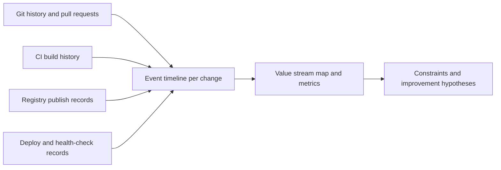

# LAB-001-01 — Evidence-based value stream map of a real delivery path

> **Assessment mode.** This file gives the scenario, requirements, constraints, and acceptance criteria. It does not give commands, and it does not describe the Phase 2 failure. Hints are released by the mentor on the ladder in `EDITORIAL_GUIDELINES.md` §6 and are recorded.

## 1. Lab ID
`LAB-001-01`

## 2. Book part and chapter reference
Part `P01` · Chapter [`CH-001`](../../chapters/part-01-devops-foundations/ch-001-from-silos-to-devops.md) · Section 1.1 · Concept 1.1.1 *Plan-driven delivery, batch releases, and queues*

## 3. Concept being tested
Where elapsed time goes in a delivery path. The difference between **lead time** and **process time**, and the mechanisms that create waiting (queues, batch size, handoffs, feedback delay, high utilisation). A second concept is tested implicitly: whether your **measurements are trustworthy**.

## 4. Difficulty level
**L2 — Guided implementation** for Phase 1. Phases 2 and 3 are designed to test **L3 — Independent engineering**.

## 5. Estimated time
Phase 1: 3–6 hours · Phase 2: 1–2 hours · Phase 3: 1–2 hours · Phase 4: about 1 hour. *These are assumptions; record your actual time so that the estimate can be corrected.*

## 6. Workplace scenario

**Engineering ticket ENG-LAB-0001 — Where does the time go between "merged" and "live"?**
*Type:* Investigation · *Priority:* Normal · *Requested by:* a product owner (illustrative)

A stakeholder asks how long changes really take to reach users, and why. Opinions differ: some say the pipeline is slow, some say reviews are slow, some say releases are batched. Nobody has measured it. Before anyone proposes a tool or a new hire, you are asked for an **evidence-backed picture** of the current delivery path of **one AirDive service**: how long changes take, where they wait, and what the evidence suggests about why.

*The framing of the request is illustrative. The evidence you collect must be real.*

## 7. Engineering requirements
- **R1.** Someone else can reproduce your result from your evidence trail.
- **R2.** Every timestamp has a named source and is expressed in UTC.
- **R3.** Active time and waiting time are separated, and each classification is justified.
- **R4.** Statistics suit a small sample: show the raw data and report median and range, not only a mean.
- **R5.** Data gaps are stated, with the likely direction of the bias they cause.
- **R6.** Improvement proposals are **hypotheses with a test**, not conclusions presented as facts.

## 8. Starting environment
**Read-only access** to the history of one AirDive service: Git history and pull requests, CI build history, image-registry publish records, and deployment or health-check records.

*Fallback.* If AirDive evidence is unavailable or confidential, use a public repository that shows CI run history and tagged releases, and record the substitution in your write-up.

**Do not trigger builds, re-run pipelines, deploy, or change any setting.**

## 9. Architecture diagram

*Caption.* Evidence flows from independent sources into one timeline per change. Where two sources disagree, the disagreement is itself a finding.

## 10. Required tools
Git; read access to your repository host and CI; a text editor; a spreadsheet **or** a small script in a language of your choice; a Mermaid-capable viewer (GitHub renders Mermaid). Nothing needs to be installed.

## 11. Constraints
- **Read-only.** No changes to any system.
- **No secrets, tokens, private keys, internal hostnames, or internal IP addresses** in anything you share. Use placeholders such as `HOST-A`.
- **UTC** for every timestamp.
- **Unbiased sample.** Choose changes by a stated rule (for example, "the five most recent production deployments from the main branch"), not by picking convenient ones.
- **Time-box Phase 1 to 6 hours.** Write down where you stopped.
- **No estimated or reconstructed timestamps.** If a timestamp cannot be found, record `not found`.

## 12. Tasks (Phase 1 — Build and verify)
- **T1.** Define precisely what counts as a *change*, when its clock **starts**, and when it is **done**. Write each definition as one sentence that someone else could apply.
- **T2.** Choose a sample of **at least five** changes that reached production, using a stated selection rule.
- **T3.** For each change, build an event timeline with **at least six** events (for example: first commit, pull request opened, review complete and merged, CI started and finished, artifact published, deployment started, deployment verified healthy). For every timestamp record its **source**.
- **T4.** Classify each interval between events as **active** (a person or system is working on it) or **waiting** (the change is in a queue), and justify each classification.
- **T5.** Per change, compute **lead time**, **process time**, and **flow efficiency**. Across the sample, report **median, minimum, and maximum**, and the **deployment frequency** over the observation window (state the window).
- **T6.** List every **manual step** and every **undocumented knowledge dependency** (a step that only works because someone remembers to do it).
- **T7.** Identify the **top three constraints**. For each, name the mechanism (queue, batch size, handoff, feedback delay, utilisation) and cite the evidence.
- **T8.** State the **data gaps** and the likely direction of bias each introduces.
- **T9.** Propose **two improvement hypotheses**. For each: the metric it should move, the expected size of the effect and why, how you would test it, and what could get worse.
- **T10.** Produce a **Mermaid value stream map** and a **one-page write-up**.

## 13. Acceptance criteria
- **AC1.** Definitions (T1) are unambiguous and consistently applied.
- **AC2.** The sample has at least five changes, with a stated, unbiased selection rule.
- **AC3.** Every timeline has at least six events, each with a source and a UTC timestamp, or an explicit `not found`.
- **AC4.** Active and waiting intervals are classified with reasons.
- **AC5.** Lead time, process time, and flow efficiency are computed per change; the sample summary shows median and range; the arithmetic is reproducible from the raw table.
- **AC6.** Manual steps and knowledge dependencies are listed.
- **AC7.** Three constraints are named with a mechanism and supporting evidence; none rests on opinion alone.
- **AC8.** Data gaps and bias directions are stated.
- **AC9.** Two hypotheses each have a metric, an expected effect, a test, and a stated risk.
- **AC10.** The write-up marks each section with a **confidence rating (1–5)**.

## 14. Validation procedure
1. **Evidence trace.** The mentor picks three cells from your table at random. For each you show the source and recompute the value independently.
2. **Definition check.** The mentor applies your definitions to one change you did not include and compares the result with what you would have recorded.
3. **Sample-bias check.** The mentor asks how the sample could be unrepresentative and whether your selection rule could have produced that.
4. **Constraint-versus-data check.** Each named constraint must be traceable to specific rows of your table.

## 15. Failure scenario
**Phase 2 — released by the mentor after Phase 1 is accepted.** It will challenge whether your measurements stay trustworthy under conditions that real data presents. Its contents are deliberately **not** in this file. No system is damaged; the thing under test is your **method and evidence**.

## 16. Troubleshooting requirements
In Phases 2 and 3 you follow the evidence-driven protocol in `EDITORIAL_GUIDELINES.md` §8. For every discrepancy: the symptom, the evidence, ranked hypotheses, the diagnostic you will use and what you expect it to show, what result would falsify the hypothesis, the root cause, the corrected method, and an independent verification. A number may change only if the change is recorded with its reason.

## 17. Recovery procedure
Nothing is deployed, so there is no service to recover. In Phase 3, **recovery means restoring trust in your numbers**: a corrected method, a before-and-after comparison that explains every changed figure, and an updated list of data gaps.

## 18. Cleanup procedure
No infrastructure was changed; **confirm that in your write-up**. Delete or secure any exported logs and screenshots, check that your notes contain no secrets or internal identifiers, and record where the raw evidence is stored.

## 19. Engineering review
The reviewer checks that: every number is traceable; definitions are applied consistently; the sample is defensible; waiting is not mislabelled as work (or the reverse); medians and ranges are used where the sample is small; constraints follow from the data; hypotheses are testable and name their risks; no secrets leaked.

## 20. Architect challenge
1. Design a **to-be delivery path** that would halve your median lead time **without increasing the change failure rate**. Use the mechanisms of §1.1.1 (WIP, utilisation, batch size, handoffs) to justify it. State what could get worse and how you would detect that early.
2. *Optional extension.* Write a small simulation (any language) of a four-stage pipeline with random arrivals and random service times. Show how mean lead time changes as utilisation rises. Compare the shape of the curve with your measurements and state the limits of the model.

## 21. Documentation deliverable
A file in your own notes repository, `docs/delivery-flow/vsm-<service-placeholder>-<yyyy-mm-dd>.md`, with these sections: *Scope and definitions · Sample and selection rule · Timeline table with sources · Metrics · Value stream map (Mermaid) · Constraints · Manual steps and knowledge dependencies · Data gaps · Hypotheses · Confidence ratings.*

**Submitting.** Paste the redacted write-up and table in chat, or commit it and share it. Include your **actual time spent** and any hints used.

---

## Level descriptors for this lab

| Level | What it looks like |
|---|---|
| 1 | Partial timelines; sources missing; lead time and process time confused |
| 2 | Complete, sourced timelines; correct arithmetic; constraints named from the data |
| 3 | As level 2, plus independent verification, honest gaps, and a method that survives Phase 2 with a recorded, justified correction |
| 4 | As level 3, plus a to-be design that argues from mechanisms and anticipates side effects |

## Assessment record (completed by the mentor)

| Dimension | Level (1–5) | Evidence | Hints used (H0–H4) |
|---|---|---|---|
| Conceptual understanding | | | |
| Independent implementation | | | |
| Troubleshooting and root-cause analysis | | | |
| Production operations and reliability | | | |
| Architecture and engineering judgement | | | |
