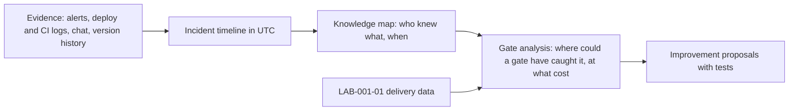

# LAB-001-02 — Handoff-chain reconstruction of a real incident

> **Assessment mode.** This file gives the scenario, requirements, constraints, and acceptance criteria. It does not give commands, and it does not describe the Phase 2 failure. Hints are released by the mentor on the ladder in `EDITORIAL_GUIDELINES.md` §6 and are recorded.

## 1. Lab ID
`LAB-001-02`

## 2. Book part and chapter reference
Part `P01` · Chapter [`CH-001`](../../chapters/part-01-devops-foundations/ch-001-from-silos-to-devops.md) · Section 1.1 · Concept 1.1.2 *The development–operations divide: incentives, handoffs, and change control*

## 3. Concept being tested
How information and decisions flow through handoffs during a real incident. Whether you can separate what was **knowable at the time** from what is known in hindsight. Whether a proposed change gate would have helped, and what it would cost across all other changes (mechanisms 6–8 of §1.1.2).

## 4. Difficulty level
**L2 — Guided implementation** for Phase 1. Phases 2 and 3 are designed to test **L3 — Independent engineering**.

## 5. Estimated time
Phase 1: 3–5 hours · Phase 2: 1–2 hours · Phase 3: 1–2 hours · Phase 4: about 1 hour. *These are assumptions; record your actual time.*

## 6. Workplace scenario

**Engineering ticket ENG-LAB-0002 — Who knew what, and when?**
*Type:* Investigation · *Priority:* High · *Requested by:* an engineering lead (illustrative)

After a production incident, a proposal circulates: every release must in future be approved by a second person outside the team. Before the decision is made, you are asked to reconstruct how information and decisions flowed during **one real incident**, and to test with evidence whether the proposed gate would have changed the outcome and what it would cost.

*The framing is illustrative. The evidence must be real. If you wore several hats during the incident, treat each hat as a separate role and note where context was lost between them.*

## 7. Engineering requirements
- **R1.** The timeline is built from sources, in UTC. Memory-only entries are labelled *Recollection (unverified)*.
- **R2.** Roles, not names, appear throughout. The language is blameless.
- **R3.** Every entry is tagged *observation*, *action*, or *interpretation*.
- **R4.** For each key decision, the information available at that moment is written down **before** the outcome is described.
- **R5.** The gate hypothesis is tested against evidence, with the cost of each gate estimated from data (your `LAB-001-01` sample) or from clearly stated assumptions.
- **R6.** Improvement proposals act earlier (prevent or detect sooner) or reduce blast radius, and each has a test.

## 8. Starting environment
**Read-only** evidence of one real incident: alerts, deployment and CI logs, chat or ticket history, version-control history, and monitoring. Your `LAB-001-01` data is used for the gate-cost estimate.

*Fallback.* If no suitable incident has surviving evidence, use a public post-incident report published by the affected organisation, state the substitution, and treat the report's own text as the evidence (you cannot verify it independently).

**Do not change any system, rerun any job, or contact anyone to alter records.**

## 9. Architecture diagram

*Caption.* Evidence becomes a timeline, then a knowledge map, then a test of the proposed gate. The delivery data from `LAB-001-01` supplies the cost side of the analysis.

## 10. Required tools
Version-control and CI history; whatever records your chat, tickets, and monitoring keep; a text editor; a spreadsheet or small script; a Mermaid-capable viewer. Nothing needs to be installed.

## 11. Constraints
- **Read-only.** No changes to any system or record.
- **Blameless, roles only.** No names, no "should have". Describe what each role could see.
- **No secrets, tokens, private keys, customer data, internal hostnames, or internal IP addresses** in anything you share. Use placeholders.
- **UTC** for every timestamp. No estimated or reconstructed timestamps: record `not found`.
- **Preserve evidence first.** Check how long each source is retained and copy what you need, redacted, before you analyse it.
- **Time-box Phase 1 to 5 hours.** Write down where you stopped.

## 12. Tasks (Phase 1 — Build and verify)
- **T1.** Select the incident and justify the choice. List the evidence that survives and the retention risk of each source.
- **T2.** Define precisely the incident's *start*, *detection*, *mitigation*, and *resolution* events.
- **T3.** Build a timeline of **at least twelve** events, each with a source and a UTC time (or `not found`).
- **T4.** Tag every entry as an *observation*, an *action*, or an *interpretation*.
- **T5.** Build a **knowledge map**: for each role, what they knew at each key moment, and how and when they learned it (channel and delay).
- **T6.** List every **handoff**: from whom to whom, by what channel, after what delay, and what context was kept or lost.
- **T7.** For **three key decisions**, write the decision context (information available, options visible, pressures) **before** reading the outcome in your own timeline. Then compare it with what happened.
- **T8.** **Gate analysis.** Identify the change, if any, that preceded the incident. For three candidate gates (peer review of the change, approval by an external board, a pre-release checklist) say: what information the gate would have had, whether it would plausibly have caught the problem and at what point, and what it would have cost across **all** changes in your `LAB-001-01` sample (added waiting time and any effect on batch size). State your assumptions.
- **T9.** Propose **two improvements** that act earlier or limit blast radius. For each: expected effect, how you would test it, and what could get worse. Produce a one-page write-up and a Mermaid timeline or sequence diagram.

## 13. Acceptance criteria
- **AC1.** The incident choice is justified, and evidence retention is recorded.
- **AC2.** The four defining events (T2) are unambiguous.
- **AC3.** The timeline has at least twelve entries, each with a source and UTC time or `not found`.
- **AC4.** Every entry is tagged observation, action, or interpretation, and the tags are defensible.
- **AC5.** The knowledge map shows, for each role and key moment, what was known and how.
- **AC6.** Every handoff is listed with channel, delay, and context kept or lost.
- **AC7.** Three decision contexts were written before the outcome, and the comparison with the outcome is honest.
- **AC8.** The gate analysis covers three gates; each states the information available, the plausible effect, and a data-based or assumption-based cost.
- **AC9.** Two improvements each have an expected effect, a test, and a stated risk.
- **AC10.** The language is blameless and role-based, and each section carries a **confidence rating (1–5)**.

## 14. Validation procedure
1. **Evidence trace.** The mentor picks three timeline entries at random. For each you show the source.
2. **Hindsight test.** The mentor takes one decision and gives you a list of facts. You say which ones the decision-maker could have known at the time, and why.
3. **Gate-cost recomputation.** The mentor recomputes one gate's cost from your sample and compares it with yours.
4. **Language audit.** Names, blame words, and hindsight phrases ("obviously", "should have") are flagged and rewritten.

## 15. Failure scenario
**Phase 2 — released by the mentor after Phase 1 is accepted.** It challenges whether your reconstruction is fair, complete, and robust to evidence that does not fit your narrative. Its contents are deliberately **not** in this file. No system is damaged; the thing under test is your **account of the incident**.

## 16. Troubleshooting requirements
In Phases 2 and 3 you follow the protocol in `EDITORIAL_GUIDELINES.md` §8: symptom, evidence, ranked hypotheses, the diagnostic you will use and what you expect it to show, what would falsify the hypothesis, root cause, corrected account, and independent verification. An entry may change only if the change and its reason are recorded.

## 17. Recovery procedure
There is no service to recover. In Phase 3, **recovery means restoring the integrity of the account**: a corrected reconstruction, a record of what changed and why, and an updated list of evidence gaps.

## 18. Cleanup procedure
No system was changed; **confirm that in your write-up**. Store the redacted evidence in an access-controlled place, delete working copies that contain unredacted material, check that nothing in your notes names a person, and record where the evidence lives.

## 19. Engineering review
The reviewer checks that: every entry is sourced; observation, action, and interpretation are not mixed; decision contexts precede outcomes; the knowledge map is consistent with the timeline; gate costs follow from data or stated assumptions; improvements are testable and name their risks; no secrets or names appear; and the language is blameless.

## 20. Architect challenge
Design a **change-control policy** for one AirDive service that satisfies segregation of duties and a compliance-style need for evidence **without an external approval queue**. Specify risk tiers, which checks are automated, how peer review is enforced, and how the emergency path and the normal path are made the same path. Define three measures that would tell you the policy is failing (for example, the share of changes needing manual approval, time spent waiting for approval, and change failure rate). State what you would need to build, which later chapters teach it, and what circumstance would make you add a human gate back.

## 21. Documentation deliverable
A file in your own notes repository, `docs/incidents/INC-AD-<nnn>-handoff-reconstruction.md`, built on the AirDive incident intake template (`case-studies/_templates/AIRDIVE_INCIDENT_INTAKE_TEMPLATE.md`), with these additional sections: *Knowledge map · Handoffs · Decision contexts · Gate analysis · Improvements · Confidence ratings.* The intake record doubles as the evidence record for a future case study.

**Submitting.** Paste the redacted write-up in chat, or commit and share it. Include your actual time spent and any hints used.

---

## Level descriptors for this lab

| Level | What it looks like |
|---|---|
| 1 | A narrative without sources; blame language; no distinction between observation and interpretation |
| 2 | Sourced timeline; handoffs and knowledge mapped; gate analysis present but costs asserted |
| 3 | As level 2, plus decision contexts written before outcomes, gate costs derived from data, and an account that survives Phase 2 with recorded, justified corrections |
| 4 | As level 3, plus improvements that act earlier or limit blast radius, with tests and anticipated side effects |

## Assessment record (completed by the mentor)

| Dimension | Level (1–5) | Evidence | Hints used (H0–H4) |
|---|---|---|---|
| Conceptual understanding | | | |
| Independent implementation | | | |
| Troubleshooting and root-cause analysis | | | |
| Production operations and reliability | | | |
| Architecture and engineering judgement | | | |
